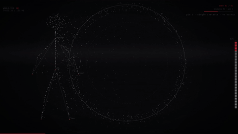
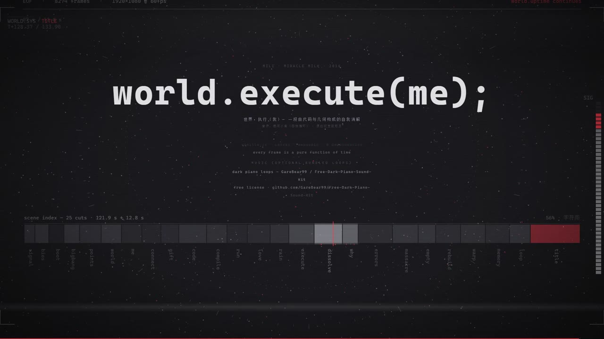
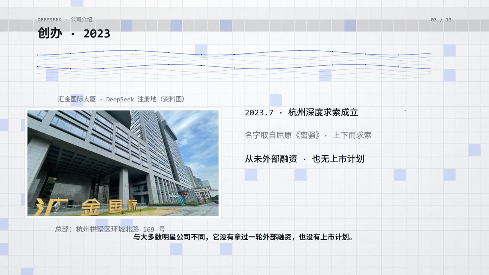

# Kine — AI 原生的确定性视频剪辑软件



<sub>以上动画是 <code>kine render</code> 的真实产出：《world.execute(me)》MV 第 26–38 秒（480p / 8fps 采样，原片 1080p60）</sub>

> **第 N 帧 = f(N)**。Kine（/kaɪn/，取自 kinesis「运动」）是第一个为 AI 智能体工作方式设计的视频剪辑 / 合成软件：
> 读事实 → 改 DSL → 量结果 → 验证出片。单一真源，逐帧确定性，可度量优于可感觉。

- **AI 智能体是首要用户**：所有能力以 CLI 子命令 + MCP 工具暴露，返回结构化事实（facts）与下一步建议（nextActions）。
- **人类作者是第二用户**：对话式改片，看 3–5 秒成品形态短预览与 changelog。
- **不提供拖拽实时编辑 UI**（非目标）；人类工程师可直接读 DSL / IR 扩展 widget 与指标。

## 用 Kine 做的片子

<table>
  <tr>
    <td align="center" width="33%"></td>
    <td align="center" width="33%"></td>
    <td align="center" width="33%"></td>
  </tr>
  <tr>
    <td align="center"><sub><b>《world.execute(me)》MV</b><br>25 幕 / 121.9s / 0 位图素材<br>Kine 的设计起点</sub></td>
    <td align="center"><sub><b>公司介绍片</b><br>5 分 28 秒 / 浅色主题<br>图表 · 图片资产 · 逐屏信息</sub></td>
    <td align="center"><sub><b>钢琴曲可视化</b><br>2 分 48 秒 / 原画满幅 + 频谱<br>背景插画由 Seedream 生成</sub></td>
  </tr>
</table>

三张截图均为 Kine 成片抽帧。画面差异说明：第一张为纯代码绘制（0 位图素材），第二张含外部照片资料，第三张的背景插画由 **Seedream** 生成（引擎只负责画面合成、频谱与浮尘）。

---


## 快速开始（M0 验收五命令）

前置：Node ≥ 22、pnpm、Edge 或 Chromium、ffmpeg（自动发现，见「环境依赖」）。

```bash
cd kine
pnpm install                            # 首次

# 1) 从模板初始化一个工程（mv-mini = 4 幕 24s / 1080p60 演示）
npx kine init demo --template mv-mini

# 2) 三层检查的项目级入口：DSL schema + purity lint（+ 运行时全轴扫描，去掉 --syntax-only 即全开）
npx kine audit --dir demo --syntax-only

# 3) 渲染一小段审查（--range 默认帧；秒用后缀：0:5s。迭代频繁可加 --preset ultrafast）
npx kine render --range 0:300 --dir demo

# 4) 全片渲染 + 终检
npx kine render --dir demo
npx kine verify --dir demo

# 5) 成品形态短预览（3–5s、成片分辨率、带音轨）
npx kine preview --at 12 --dur 4 --dir demo
```

> `npx kine` 通过 workspace bin（`packages/agent/bin/kine.mjs`）入口运行；也可等价使用
> `node packages/agent/bin/kine.mjs <cmd>` 或 `pnpm kine <cmd>`。
> ⚠️ 本仓库未发布到 npm；npm 上那个名为 `kine` 的包是无关的旧包（kinesis 客户端）。
> `pnpm install` 之后 `npx` 会优先用本地 bin，但如果它提示要下载外来 `kine`，请改用上面后两种写法。
> 所有命令未指定 `--dir` 时的定位顺序：① 启动目录向上查找 `timeline.yaml`；② 向下扫描（深度 3）唯一命中即用；③ 多个命中取**最近登记**的工程（返回 facts 会注明自动定位结果）；④ 全无则报 `E-PROJ-*` 并列出候选。`kine projects` 可查看/清理登记。

---

## 开箱有什么

仓库自带的东西全部是**代码与声明**，不含任何第三方素材：

| 类别 | 数量 | 内容 | 怎么看 / 怎么用 |
| --- | --- | --- | --- |
| 工程模板 | 2 | `mv-mini`（24s 演示片，含合成曲）/ `blank` | `kine init <目录> --template mv-mini` |
| widget | 34 | bd 族 16（标题/终端/频谱/仪表…）+ draw 族 18（地球/超立方/心形/生命游戏…） | `kine widgets`、`kine widgets info <name>` |
| 种子色板 | 11 | `noir` `midnight` `forest` `wine` `bw-high-contrast` `amber` `ember` `cyan-lab` `violet` `ice` `light-paper` | `kine library seed` 后引用 `library://core/noir` |
| SFX 合成器 | 7 | `heartbreak` `rain` `piano_motif` `keyboard` `tape` `drone` `glitch`——全部离线数学生成，**零音频素材** | `audio.sfx.events` 声明事件 + `params` |
| 转场 | 15 | A 遮罩 7（红条/百叶窗/对角/爆开…）/ B 位移 4 / C 缩放 2 / D 甩镜 2 | `shot.transition: { kind, variant }` |
| 图层类型 | 7 | `particles` `widget` `text` `image` `subtitles` `fx`，外加 `video`（明确报错禁用，见下） | `scenes[].layers[]` |
| 示例曲 | 1 | mv-mini 的 24s 曲子，由 `tools/gen-demo-song.py` 用正弦波合成，可重现 | 直接 `kine render` 即可听到 |
| 本地控制台 | 1 | 库浏览 / 音乐上传入库 / 工程列表 | `pnpm console` → `127.0.0.1:4747` |

**需要自备的**（引擎只提供接口，不附带内容）：

- **音乐**：`kine music add <file>` 导入自己的音频（转 48k + BPM/拍点分析 + 内容寻址去重），存本地库 `~/.local/share/kine/library`
- **配音音色**：见下方「配音（可选依赖）」，需自建 TTS 服务与音色档案
- **图片 / 视频素材**：`image` 图层用工程相对路径或 `library://` 引用；`video` 图层当前明确报 `E-ASSET-002`（无确定性丢帧方案，故意不支持）
- **色板 / 主题 / 版式扩展**：`kine forge create <kind> <name>` 建 draft → `kine forge register` 入库

---

## 环境依赖

| 依赖 | 用途 | 发现顺序 |
| --- | --- | --- |
| Node ≥ 22 + pnpm | 全仓运行 / workspace | — |
| Edge 或 Chromium | headless 抓帧（CDP） | `KINE_BROWSER` → ms-playwright 缓存 → Edge → Chrome |
| ffmpeg 6+（含 libx264/mpegts） | 分片编码 / 拼接 / 合流 | `KINE_FFMPEG` → `~/.local/share/kine/bin/ffmpeg.exe` → PATH → 常见安装位置 |
| Python venv（`py/kine-py/.venv`） | 音频合成 / 混音 / 像素指标 | `KINE_PYTHON` → venv → 系统 python（需 numpy/scipy/PIL） |

浏览器与 ffmpeg 的确定性参数已内置（固定字体渲染、禁用 LCD 字体平滑、`--force-color-profile=srgb` 等），保证逐帧可复现。

Python 侧车首次准备（缺了它音频合成与像素指标跑不了）：

```bash
python -m venv py/kine-py/.venv
py/kine-py/.venv/Scripts/pip install -r py/kine-py/requirements.txt   # Windows
# py/kine-py/.venv/bin/pip install -r py/kine-py/requirements.txt     # macOS / Linux
```

ffmpeg 缺失时引擎会自动去 `~/.local/share/kine/bin/` 找；把 ffmpeg 可执行文件放那里，或设 `KINE_FFMPEG` 指向它。

**配音（可选依赖）**：`kine voice` 调外部 TTS 服务——只要实现 `POST <endpoint>` 收 JSON、返回音频即可（GPT-SoVITS 的 `/tts` 就是这种形态）。仓库**不含音色模型，也不含任何音色档案**，音色需要自己建：

```bash
kine forge create voice narrator      # 档案骨架（endpoint 默认 http://127.0.0.1:9880/tts）
#   编辑 draft：ref_audio 填 3–10 秒自然语音，ref_text 必须与音频逐字一致
kine forge register narrator          # 校验：端点可达 + 参考音时长 + 文本非空
kine voice synth --name narrator --file script.txt --out assets/narration.wav
```

`script.txt` 按行分段（`#` 开头与空行忽略）。合成产出 WAV 与同名 `.schedule.json`（每段的 `starts` / `dur`，可直接用来对齐幕长或字幕）。音色档案存在 `~/.local/share/kine/library`（`KINE_HOME` 可改），不随工程走。

---

## 架构

```
Agent 接口层   @kine/agent      CLI ×32 子命令 + MCP server（每工具一个 tool）
工程层         @kine/store      工程目录 / 事务(changelog/rollback) / 缓存 / 版本 / 基线 / 锁 / 日志
编译层         @kine/dsl        timeline.yaml --(zod 校验 + lint)--> IR（含时间对照表 map 与依赖图）
渲染层         @kine/render     Edge CDP 逐帧抓帧 → ffmpeg image2pipe → .ts 分片 → concat → mux
               @kine/runtime    window.__kine = { load, jump, probe, stateHash }（纯函数逐帧）
               @kine/widgets    34 个官方 widget（bd* / draw* 两族）
音频层         @kine/audio      SFX 离线合成 + 混音（成片时钟声明，改速度不需要重录）
验证层         @kine/metrics    像素指标 / 断言引擎 / 基线 diff
侧车           py/kine-py       stdio JSON 协议：合成器 / 混音 / 像素指标（numpy+scipy+PIL）
```

数据流：

```
timeline.yaml ──compile──▶ IR ──┬──▶ 帧抓取（N worker × 独立浏览器）──▶ chunk_*.ts ──concat──▶ video.mp4
                                ├──▶ 音频（SFX 合成 + 原曲混音）──────────────mix──▶ audio.wav
                                └──▶ 依赖图 / 时间对照表 map ──▶ impact·check·verify
video.mp4 + audio.wav ──mux──▶ out/<version>/<version>.mp4 ──verify──▶ 交付
```

一个 `timeline.yaml` 描述全片。时间只写一次；**所有工具的时间参数一律使用成片秒**，返回中同时给出渲染时钟 T；
内部换算只经 `map`（`kine map --t 125.1` ⇒ `{ t, T, frame, seg, scene }`）。

---

## CLI 工具总表（32 个，与 MCP 工具一一对应）

| 命令 | 用途 | 示例 |
| --- | --- | --- |
| `init` | 从模板建工程（mv-mini / blank） | `kine init demo --template mv-mini` |
| `projects` | 已登记工程列表 / `--forget` 移除（默认 dir 解析依据） | `kine projects` |
| `info` | 工程总览（时长/帧数/幕/音频/断言/版本） | `kine info` |
| `doctor` | 工程一致性体检（可 `--fix`） | `kine doctor --fix` |
| `compile` | 编译并输出 specHash / 时间表 / 摘要（`--write-ir` 落盘 IR） | `kine compile` |
| `map` | 时间对照表：`--t` 秒→帧/幕；`--frame` 反查；无参出全表 | `kine map --t 12.5` |
| `probe` | 运行时探针：某秒的画面元素/相机/后处理/状态哈希 | `kine probe --at 12` |
| `layout` | 布局体检：重叠对 / 出画 / 贴边（各幕多点采样；`--strict` 任意重叠） | `kine layout` |
| `contact` | 接触表：均匀抽帧拼图（PNG），一眼看全片 | `kine contact --scene code --count 8` |
| `find` | 语义寻址（alias/tags/id/name），歧义时返回 AMBIGUOUS + 候选 | `kine find 标题` |
| `explain` | 字段解释：定义处行号 / 驱动关系 / 生效公式 / 改动影响 | `kine explain pace.segments[1].ratio` |
| `impact` | 影响分析：失效节点 / 保留节点 / 预计重渲与重混 | `kine impact output.duration` |
| `edit` | 事务编辑：dry-run → impact → 应用 → changelog（`--tx --quote`） | `kine edit "set scenes[code].camera.tw=0.5" --tx --quote "代码幕震屏小一点"` |
| `measure` | 指标测量（density/frame_diff/cam_jitter/audio_rms…），可带 `--expect` | `kine measure cam_jitter` |
| `audit` | 三层检查：①schema ②purity lint ③0.25s 步进运行时扫错 | `kine audit` |
| `check` | 跑全部断言（PASS/FAIL/SKIP）+ 与最近基线 diff | `kine check` |
| `baseline` | 保存/查看基线（指标 + 黄金帧 stateHash + 音频特征） | `kine baseline --save` |
| `diff` | 两个版本/基线的三联 diff（语义/指标/关键帧） | `kine diff v0.2 v0.3` |
| `preview` | 成品形态短预览（法定形态：3–5s、成片分辨率、带音轨） | `kine preview --at 12 --dur 4` |
| `render` | 渲染：全片（默认）或 `--range a:b`（默认帧，`s` 后缀为秒）；`--preset` 编码档位；`--work-dir` 工作目录（等价 `KINE_WORK_DIR`）；`--workers/--no-cache` | `kine render --range 0:5s --preset ultrafast` |
| `verify` | 成片终检：帧数/时长/音轨/接缝/黄金帧 + 写报告 | `kine verify --version v0.3` |
| `changelog` | 事务历史（用户原话 + patch + impact + 预览） | `kine changelog --since 2h` |
| `rollback` | 回滚某事务（备份优先，写新条目） | `kine rollback tx_20261007_001` |
| `cache` | 缓存状态 / LPU GC（默认上限 20GB） | `kine cache gc --max 20` |
| `versions` | 版本列表与终版指针 | `kine versions` |
| `library` | 资源库：add / list / search / tags / rm / gc / verify / pin（内容寻址） | `kine library list --kind music` |
| `music` | 音乐库：add（转 48k + 分析）/ info / analyze / beats / fit（长度匹配建议） | `kine music add song.wav --name demo` |
| `voice` | 配音音色：list / show / synth（文本或按行分段的脚本 → 旁白 WAV + schedule.json） / default（切换标配音色） | `kine voice synth --file script.txt --out assets/narration.wav` |
| `forge` | 创作层：create / save / list / register（draft → 验证 → library） | `kine forge create palette noir` |
| `style` | 风格档案：show / apply（profile + palette 事务化） | `kine style apply --ref library://ai/noir --tx --quote "换色板"` |
| `widgets` | widget 清单与参数示例 | `kine widgets info bdTerminal` |
| `rules` | 规则速查：lint 码 → 含义 / 修复示例 | `kine rules W-SYNTH-001` |

通用返回契约：`{ ok, tool, data, verdict, facts[], hints[], nextActions[], error? }`。
`verdict` 可为 `PASS | FAIL | AMBIGUOUS | NEED_INPUT` —— **AMBIGUOUS 时禁止静默选择**，必须由用户从候选项中指定（`--id`）。

## 本地控制台（人用 · 简易 UI）

```powershell
pnpm console          # 或 npx tsx console/server.ts
# → http://127.0.0.1:4747（仅绑定本机回环；--port 换端口，--no-open 不自动开浏览器）
```

- **总览**：库条目统计、磁盘剩余（C/D，<2GB 红条警示）、Kine 版本（git hash）、最近入库。
- **音乐库**：拖入/选择音频 →「上传入库」（复用 `kine music add`：转 48k 无损 + BPM/拍点分析 + 内容寻址去重）；在线试听、复制 `library://` 引用、删除条目（blob 仍被引用时自动保留）。
- **资源库**：按类型筛选、搜索、色板色块预览、复制引用。
- **工程**：已登记工程列表（含 timeline.yaml 存活检测）、一键 `kine info`、复制路径。
- 写操作仅「音乐入库 / 删除条目」两类，全部复用 kine 自身能力；渲染等重操作仍请在 CLI/MCP 执行。

## MCP 接入

MCP 服务器名 `kine`，工具名与 CLI 一致（`kine.map`、`kine.measure`…），长任务（render/verify/baseline）支持进度通知；资源：`kine://project/info`、`kine://map`、`kine://baseline`、`kine://rules`（规则含义与修复）、`kine://library`（资源库）、`kine://widgets`、`kine://music`。

```json
{
  "mcpServers": {
    "kine": {
      "command": "node",
      "args": ["<path-to>/kine/packages/agent/bin/kine.mjs", "mcp", "--dir", "<project-dir>"]
    }
  }
}
```

---

## 确定性体系

- **specHash**：IR 归一化哈希 = 工程身份（缓存、基线、回归的根键）。
- **visualHash**：帧内容根键（排除音频/断言）——**改音频不重渲帧**，缓存按 visualHash 分目录。
- **stateHash**：单帧状态归一化哈希（场景/镜头/相机/元素盒/测量），跨会话可复现，用于黄金帧回归。
- **逐帧纯函数**：`__kine.jump(T)` 全量重算；四禁令（禁 Math.random / 累积状态 / 墙钟 / CSS 自走动画）由 `audit` 扫描源码强制。
- **字节级复现验收**：`npx tsx tools/repro-check.ts examples/mv-mini/timeline.yaml 0:120`
  同一工程两次渲染（`--no-cache`）产物逐字节一致。
- **分片**：边界只落 pace 断点与幕边界；4 worker 与单 worker 产物一致（同 specHash）。
- **跨版本哈希标记**：`HASH_SCHEME`（IR 规范形式版本，`kine-hash/1`）与 `RENDER_VERSION`（渲染像素行为版本，`kine-render/1`）显式进入哈希输入。
  源码升级导致标记 bump 时 specHash/visualHash 会变化、首次 render 可能全量重渲，属**预期且可解释**的行为；
  维护者改变 IR 编译形式或渲染像素输出时**必须**同步 bump 对应常量并在此记录，用户可凭标记判断“是升级导致还是工程被改”。

### 改片标准工作流

```
find（定位元素）→ explain（看公式）→ measure（先量）→ impact（算失效范围）
→ edit --tx --quote（事务提交，自动 changelog）→ audit → check
→ preview（给用户看 3–5s）→ render → verify → 交付 out/<version>/
```

回滚：`rollback <txId>`；历史：`changelog`。

---

## 目录结构

```
kine/
├─ packages/
│  ├─ dsl/        时间映射 / schema / lint / 依赖图 / patch / 相机公式（单一真源）
│  ├─ runtime/    jump / probe / stateHash / 合成器 / 转场库 / 后处理
│  ├─ widgets/    34 个官方 widget
│  ├─ render/     CDP 抓帧 / ffmpeg 编码 / 分片 / 缓存 / 拼接 / mux
│  ├─ audio/      音频计划 / 合成 / 混音 / env
│  ├─ metrics/    像素指标 / 断言引擎 / 相机解析复算
│  ├─ store/      工程布局 / 事务 / 缓存索引 / 版本 / 基线 / 日志 / 锁 / 用户资源库 / kine-py 桥
│  └─ agent/      CLI（bin/kine.mjs）+ MCP server + 29 工具
├─ py/kine-py/    Python 侧车（stdio JSON）：synth/mix/env/像素指标
├─ examples/mv-mini/   演示工程（含 demo 曲 assets/song.wav）
├─ fixtures/      7 个回归工程（accel-cut / ambiguous / double-pace / env-flash / hud-clip / pump-tw / short-transition）
├─ tests/         vitest 单元测试（时间映射/分片/patch/lint/impact/find/edit/expect/metrics-spike）
└─ tools/         构建与冒烟脚本（build-web / smoke-* / repro-check / check-fixtures …）
```

工程目录（如 `demo/`）：

```
demo/
├─ timeline.yaml            单一真源
├─ assets/                  音乐与素材
└─ .kine/
   ├─ ir/project.ir.json    编译产物（含时间表与依赖图）
   ├─ work/<hash8>/         分片与调试帧（缓存）
   ├─ cache/                音频 / env / 指标缓存（索引 + LRU）
   ├─ out/<version>/        video.mp4 + <version>.mp4 + report.md（交付物）
   ├─ baseline/<v>.json     基线
   ├─ reports/              check / diff 报告
   ├─ changelog.jsonl       事务史（用户原话逐字）
   └─ backup/               事务前 YAML 备份
```

---

## 测试与验收状态

| 项目 | 状态 |
| --- | --- |
| `npx vitest run` | 17 文件全绿（含 dir 自动定位、kine-py 协议行净化与静音窗回归、transition_spike 边界分类、v3/v4/v5/v6 守卫、voice 停顿归一化） |
| 7 个回归 fixture | 编译验证全绿（3 个预期命中 lint 错误码；short-transition 用于 transition_spike 设计内豁免实测） |
| M0 五命令验收（mv-mini） | `init`（绝对/相对路径 × blank/mv-mini 模板）· `audit`（语法 0/0、purity 0、运行时全轴扫描 0 错误）· `render`（v0.4，1440 帧全缓存命中，6.8s）· `verify`（帧数/时长/音频/抽检全过，tail-clean 为已解释 WARN）· `preview --at 12 --dur 4`（含音轨成品形态）——全 PASS |
| MCP 冒烟 | initialize / tools(29) / map / probe / resources(7) 全通过 |
| v2 冒烟（库/创作/音乐/风格） | `library add/list/tags` · `music add`（BPM≈100 置信度 0.89）· `forge create → register`（自动打 @red）· `style apply` 事务（demo-mv2，audit PASS）——全 PASS |
| 字节级复现 | `tools/repro-check.ts` 双跑 120 帧 sha256 逐字节一致（534f795a…） |
| 工程身份确定性 | specHash 位置无关（拷贝工程/换目录哈希一致）；音频-only 改动不失效帧缓存（visualHash 解耦实证） |

已知限制：`verify` 的 tail-clean 对“SFX 延至片尾/收尾偏响”的工程会给 WARN（属设计内、按 L-AUD-002 解释；可用 `audio.tail_fade` 调整——mv-mini 模板已用 `1.0` 使 fresh verify 0 WARN）；
`render --range` 默认帧语义（秒用 `0:5s` 后缀）；M7 只读预览 UI 未实现（非目标优先）。
`transition_spike` 对**设计内边界自动豁免**（幕头红条白闪装置、镜头转场窗口、硬切瞬间、**强拍白闪 beat-flash**——facts/extras 单列豁免计数），只有设计外的孤立尖峰（卡顿/闪回）才计入命中。

## 音频：SFX 参数表与 tail_fade

每个 SFX 事件可带 `params`；**未识别的参数键在 audit 报 `W-SYNTH-001`（warn），参数值非法（如 `notes: 4`——需写成频率数组 `[220.0, 261.63]`）报 `E-SYNTH-001`（error）**——都在 audit 阶段挡住，不再拖到 render 才炸。

| sfx | 可用 params |
| --- | --- |
| `heartbreak` | （无） |
| `rain` | `drops_per_sec` · `bed_gain` · `dur` |
| `piano_motif` | `notes` · `spacing` · `gain` · `chord` · `chord_at` · `dur` |
| `keyboard` | `period` · `count` · `dur` |
| `tape` | `dur` |
| `drone` | `freq` · `dur` |
| `glitch` | `rate` · `blue_freq` · `dur` |

- `audio.tail_fade`（0.1–3s，默认 0.4）：SFX 总线末段余弦淡出时长；改动只重建音频缓存，帧缓存不受影响。mv-mini 模板用 `1.0`，末 0.2s 峰值实测 -35.9 dB。
- 合成器版本 `kine-synth/2`（piano_motif 的 `gain` 旋钮已生效；`keyboard` 用 `count` 控制点击数——写 `clicks` 会在 audit 报 `W-SYNTH-001`）。

**MCP 常驻提示**：MCP 服务器进程常驻，修改 Kine 源码后需重启服务器（OpenCode 中重启服务或重开会话）才会加载新代码。

## v2：资源库与创作层

v2 在「护栏即唯一值」之上引入分层自由度（Tier 模型，全部**可选、有默认值**）：Tier0 铁律（符号/色彩/post 上限、purity、内置转场 15 种）不可动；Tier1 风格档案（`theme.profile: core|extended|free` + `theme.palette`）从注册色板中选配；Tier2 注册扩展（色板 / 主题 / 版式 / SFX 预设 / 蓝图进库需过校验）。默认 `core` 的工程行为与 v1 完全一致。

- **用户资源库**（跨工程）：`~/.local/share/kine/library/`（`KINE_HOME` 可覆盖）；内容寻址（`blobs/<sha256>`）+ `index.json`。
  - `kine library add <file> --kind music|theme|palette|layout|blueprint|preset|sfx-preset|xf-suite|kit|voice|image|video|font`
  - `kine library list|search|tags`；`rm|gc|verify`（`verify --dir <工程>` 检查工程引用与库内容漂移）
  - 工程内引用：`library://<id>`（或 `@tag`）；被引资产 sha256 参与 **specHash 的 assets 子键**——库内容变化在下次 compile 即显现（不静默）。
- **创作层**：`kine forge create <kind> <name>` 产出 draft（自动骨架，或 `--file` 自备 YAML）→ `kine forge register <name>` 自动验证（结构校验 + 可选 `--visual` 黑电平/密度/边缘带门槛）→ 晋升 `library` 状态并自动打色相标签；验证失败**不阻断**，保持 draft。
- **音乐库**：`kine music add <file> --name demo`（ffmpeg → 48k 无损 + 分析：时长/峰值/RMS/BPM 与置信度/拍网格）；`kine music info|analyze|beats|fit`——`fit` 比对音乐长度与成片时长，不匹配时给 2–3 个选项（延长终幕 / 提前淡出 / 循环补段；不建议变速）。
- **风格档案**：`kine style show` 查看当前 profile 与色板解析；`kine style apply --ref library://ai/noir --tx --quote "…"` 走标准事务（impact 保留全部音频节点，自动 audit）。
- 新 MCP 资源：`kine://rules`（规则含义与修复示例）、`kine://library`、`kine://widgets`、`kine://music`。
- 哈希兼容：未显式设置 `profile`/`palette` 的旧工程，specHash/visualHash **逐字节不变**（canonical 投影）。

## v3：护栏三修与种子内容

基于第三轮外测的四个 P0 与三个 P1，v3 修复「校验对象与错误路径」（旧工程行为不变）：

- **range 严格校验**：`measure` / `find` 的 `--range` 一律为成片秒 `a:b`（如 `0:5` / `12.5:14`），严格解析——非法值直接报 `E-METRIC-003` / `E-TIME-003`（不再静默退化为默认采样）。
- **音频静默降级归零**：`render` 交付路径混音失败抛 `E-AUDIO-MIX-001`（带 hints；可 `--no-audio` 跳过）；其余工具失败也会留痕（progress/stderr），不再有「无声成片 + 误导错误码」。
- **lint 与渲染同一对象**：颜色/字体/后处理检查作用于 **palette 应用后的有效主题**；色板注册期即校验 bg（非法→`E-LIB-003`、过亮→`E-COLOR-002`）；新增 `W-LIB-002`（色板与 core 视觉完全相同）。
- **SFX 参数值校验**：键名白名单（`W-SYNTH-001`）之外再校验值类型/范围，非法报 `E-SYNTH-001`（如 `notes` 必须是频率数组）。
- **内置种子**：`kine library seed` 一键注册 10 个官方色板（`core/noir`、`core/midnight`、`core/forest`、`core/wine`、`core/bw-high-contrast`、`core/amber`、`core/ember`、`core/cyan-lab`、`core/violet`、`core/ice`）——幂等（已存在跳过）；引用：`theme.palette: library://core/noir` 或 `kine style apply --ref library://core/noir`。
- **edit 支持数组/对象值**：`kine edit "set scenes[s].layers[l].props.notes=[220.0, 261.63]" …`（带引号的 `"[..]"`/`"{..}"` 会自动去引号）。

## v4：文本插值、布局体检与静默失效护栏

基于第四轮外测（布局无检查 / 文本静态 / 配置静默失效 / 文档与输出问题）：

- **文本插值（第 N 帧 = f(N) 的文本版）**：text 层 `content` 支持 `{frame}`（帧号）、`{t}` / `{T}` / `{lt}`（秒），可带格式如 `{t:.2f}`；含 `{` 才进入插值（旧工程逐字节不变）。未知占位符报 `W-TEXT-001`（按字面显示）。计数类画面直接写 `content: 'FRAME {frame}'`。
- **布局体检 `kine layout`**：各幕多点采样（lt 25/50/62/75%）→ 重叠对（交集/较小盒 ≥8%；背景/全屏层除外）、出画（>8px）、贴边（<24px）；强重叠 ≥25% 或出画 → FAIL。配合 **`kine contact`**（均匀抽帧 → 接触表 PNG）快速目检全片。
- **色板静默覆盖显式化**：palette 生效时，显式写死的 `theme.bg/text/text_dim/accent_secondary` 会被覆盖——现在报 `W-COLOR-004`（facts 附色板实际值）；10 个种子色板补全 `accent_secondary`（`profile: extended` 下不再回退锁死 `#4da3ff`）；`kine library seed` 对内容变化的种子自动刷新（条目版本递增）。
- **死参数修复**：`bdTerminal.speed` 真实生效（日志滚动速度倍率）；`bdTitle` 默认**左对齐**，新增 `align: left|center|right`。
- **widget 参数可发现**：`kine widgets info <name>` 给出**视觉描述 + 完整 props 表（类型/默认值/说明/注意）**；未知 props 报 `W-WIDGET-001`（`audit` 阶段拦下）。
- **写保护 `E-PROJ-006`**：未显式 `--dir` 且目录来自「向下扫描 / 登记表兜底」时，`edit` / `rollback` / `style apply` / `render` 拒绝执行（防误改示例工程）；请显式传 `--dir`。
- **渲染环境加固**：分片缓存要求 `.ok` 完整性凭据（文件大小复核；中断留下的截断块不再被误判为缓存命中）；磁盘剩余 <1GB 报 `E-RENDER-007`（hints 含 `kine cache gc` 与 **`KINE_WORK_DIR`** 环境变量——支持把工作区重定向出 C 盘）。
- **输出精简**：`kine edit` 的 diffs / summary / facts 对长值自动折叠（不再整段 `scenes` 重复四遍）；`check` 的断言消息与报告对比例指标补百分数解读（如 `<= 0.6（比例 ≤ 60%）`，0.88% 判 PASS 的依据一眼可见）。
- **MCP 版本标记**：serverInfo 版本包含 git 短哈希——源码改动并重启后，一眼确认加载的是哪一版。

## v5：浅色模式、资产管线与字幕层

基于第五轮外测（浅色主题被封死 / image 图层静默失效 / 无字幕层 / 崩溃与误导性 verdict / 手感层）：

- **浅色模式（`theme.mode: light`）**：浅底色与深字获得合法路径——E-COLOR-002 改判「通道 ≥180」；新增 `E-COLOR-005`（正文对比度 ≥4.5:1，WCAG）；指标自动切浅底口径（`density`/`edge_band` 以暗像素计内容，`black_level` 报告**白电平**）；色板可声明 `mode: light`（注册期同套校验）；`dark`（默认）行为与哈希逐字节不变。
- **图片资产管线接通**：渲染管线从 IR 收集 `image` 图层（本地路径以 timeline 为基准 / `library://` 库 blob）→ 预解码注入运行时。缺资产：audit 期 `E-ASSET-001` 拦下 + 运行时**贴屏横幅**提示（不再有画外红框骗人）；`video` 图层明确报 `E-ASSET-002`（无确定性丢帧方案——反例比静默失败好）。
- **字幕层 `kind: subtitles`**：内联 `cues` 或引用 `.srt`（编译期内联进 IR）；自动换行 + 逐行居中，`zone` 定位（默认下缘）；lint：`E-SUB-001`（时间非法）/`W-SUB-001`（重叠）/`W-SUB-002`（SRT 坏块）。`render` 完成后自动把字幕导出为 `<version>.srt` 到交付目录。
- **布局与排版**：`place.anchor: tl|tr|bl|br|center`（右对齐 HUD 不再靠猜坐标）；文本 `style.line_height` 可显式；字号换算式写死入文档：`px = size × base × fontScale × ds × 1.06`（ds = S/1080）。
- **verdict 三段式**：`audit` 首行给出「blocking（引擎无法编译/运行）/ policy（设计纪律）/ 警告」分类计数；`check` 汇总 `PASS n / FAIL(blocking) n / FAIL(warn) n / SKIP n`——warn 级未达项不再混进顶层 verdict（报告头单独标注）。
- **MCP 陈旧与 fail-open 修复**：serverInfo 版本含 git 短哈希 + **bundle 哈希**；`doctor` 新增宿主 bundle 新鲜度检查（源码比 bundle 新 → WARN：重建 + 重启）；`W-WIDGET-001` 对「不在元数据注册表」的 widget 也会报警（不再静默跳过校验）；`registerWidget` 重名时 console.warn；FFmpeg 管道 EPIPE 吞并为分片失败（磁盘写满不再拖崩 MCP 进程）。
- **冒烟实证**：图片资产注入 → `probe` 显示 `img1=ok / img2=missing-asset`；缺失资产 audit 报 `E-ASSET-001`；mv-mini specHash `566b68cc`、visualHash `6884bbd2` **零变化**（v5 对既有工程零像素影响，分片缓存直接复用）。
- 延后（已登记）：`render --async + kine jobs`、运行时 `library://` widget-pack 加载（`custom.` 前缀）、meta 与源码一致性生成、`audio.voice` 独立轨。

## 规格文档

开发依据：内部设计规格书 01–10（产品定位 → 路线图），**不随仓库分发**；
以及源项目《world.execute(me) MV 制作全案》的全部经验固化（每个历史坑均已落成 lint / 指标 / 流程）。

另有**视觉设计学习文档**：`docs/视觉设计-学习指引.md`（配色/字体/版式/Logo 的 AI 决策映射与 Kine 落点）。
配套的 10 本设计书 PDF 属第三方版权资料，**不随仓库分发**，需要时自行备到本地。

---

## 支持

如果 Kine 帮你省下了加班时间，可以请作者喝杯奶茶——**完全自愿，不影响任何功能**。


